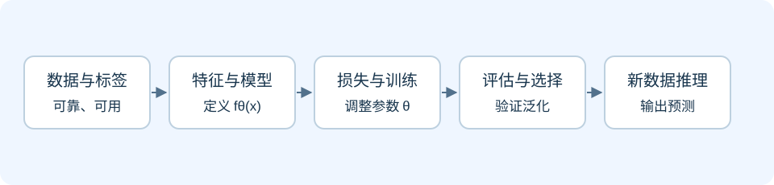
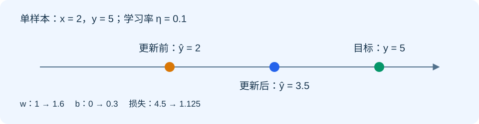
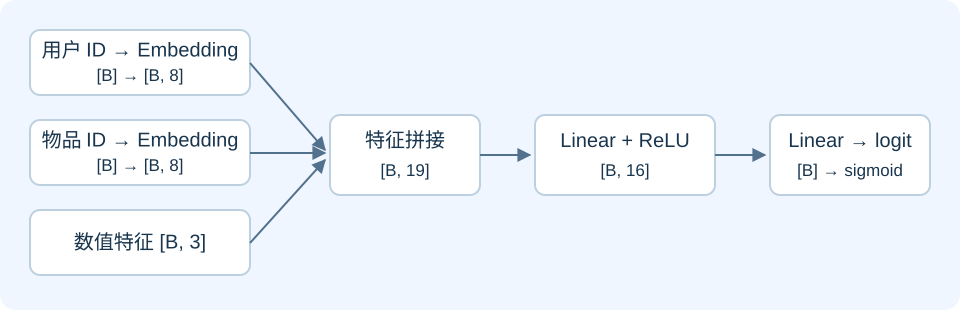
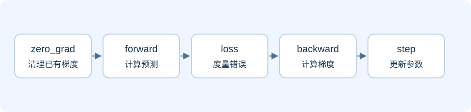
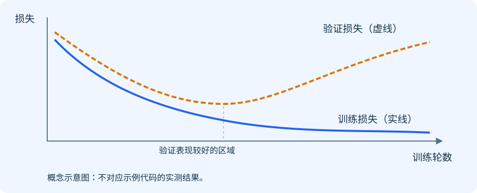

# 第一场：模型如何学习

> 从数据到参数：用 Embedding + MLP 理解机器学习与训练。

## 讲解目标与安排

面向具备基本 Python 经验的工程师，建议用 75～90 分钟讲解。听众结束后应能解释：模型与参数的关系、一次训练迭代的步骤、Embedding 与 MLP 的作用，以及训练和推理的区别。

贯穿问题：给定一个用户和一个物品，如何预测这个用户会不会点击？我们用一个教学版点击率模型回答这个问题。真实推荐系统还涉及召回、排序、曝光偏差和多目标优化，本场聚焦最小训练闭环。

| 环节 | 建议时间 | 要回答的问题 |
| --- | --- | --- |
| 机器学习任务与数据 | 15 分钟 | 模型到底学什么？ |
| 参数、损失与梯度 | 20 分钟 | 错误如何变成参数更新？ |
| Embedding + MLP | 15 分钟 | 离散 ID 如何参与预测？ |
| PyTorch 训练与推理 | 20 分钟 | 代码如何实现训练闭环？ |
| 评估与讨论 | 10 分钟 | 怎么判断模型学得好？ |

## 1. 机器学习：从规则到可学习函数

传统程序由人明确写出规则；机器学习先选定一类带参数的函数，再用数据调整参数。模型不是“自己知道答案”，而是通过训练，使它在指定目标下减少预测误差。

我们将模型写成 `ŷ = fθ(x)`：`x` 是输入，`θ` 是参数，`ŷ` 是预测。训练改变 `θ`；推理使用已经训练好的 `θ` 处理新输入。

### 1.1 学习方式与任务类型是两个维度

| 维度 | 类别 | 含义与例子 |
| --- | --- | --- |
| 学习方式 | 监督学习 | 使用输入与标签学习，如点击预测、房价预测 |
| 学习方式 | 无监督学习 | 挖掘未标注数据的结构，如聚类 |
| 学习方式 | 强化学习 | 通过环境反馈与奖励学习策略，如控制与决策 |
| 任务类型 | 分类 | 预测类别或类别概率，如是否点击 |
| 任务类型 | 回归 | 预测连续数值，如价格、观看时长 |
| 任务类型 | 排序 | 对候选项按相关性或收益排序 |
| 任务类型 | 生成 | 生成文本、图像或其他序列 |

分类和回归属于任务类型。推荐系统可以把点击率预测作为二分类任务，再按预测分数排序；排序任务本身也可以使用专门的排序损失。

### 1.2 数据、模型与训练策略共同决定结果

- 数据：输入是否有信息、标签是否可靠、样本是否代表上线场景。
- 模型：采用哪些特征、怎样组织计算、参数容量有多大。
- 训练策略：损失函数、优化器、学习率、采样方式、正则化等。
- 评估：采用什么数据切分与指标，是否匹配业务目标。

只有更大的模型，没有可靠的数据与评估，不一定带来更好的结果。



### 1.3 训练集、验证集、测试集

训练集用于更新参数；验证集用于选择超参数、模型和停止时机；测试集用于在方案确定后做最终评估。反复根据测试集结果调参，会削弱测试结果的可信度。

推荐场景常按时间切分：用较早的数据训练，较晚的数据验证或测试，以接近“用过去预测未来”的真实流程。比例不是固定标准，应根据数据规模和业务设计。

数据泄漏指训练或特征构建使用了预测时不应获得的信息，例如用点击后的行为预测是否点击，或在全部数据上拟合预处理统计量。预处理应在训练集上拟合，再应用到验证与测试数据。

## 2. 参数、超参数与模型结构

### 2.1 从一个线性模型开始

设输入 `x = 2`，目标 `y = 5`，模型为 `ŷ = wx + b`。`w` 和 `b` 是可学习参数。若初始 `w = 1`、`b = 0`，预测就是 `2`。

模型结构决定计算形式，参数决定这个形式下的具体函数。神经网络通常由多个这样的变换与非线性函数组合而成。

| 概念 | 例子 | 如何确定 |
| --- | --- | --- |
| 可学习参数 | 权重、偏置、Embedding 向量 | 训练时由优化器更新 |
| 结构超参数 | 层数、隐藏维度、Embedding 维度 | 设计时选择，用验证集比较 |
| 训练超参数 | 学习率、batch size、训练轮数 | 训练前设定，也可按策略调整 |
| 模型状态 | BatchNorm 的运行统计量 | 训练时更新，但不是梯度优化的参数 |

### 2.2 MLP 的基本计算

线性层计算 `h = xW + b`，激活函数再引入非线性，例如 `ReLU(h) = max(0, h)`。多层感知机 MLP 将线性层和激活函数组合起来。

如果连续堆叠线性层而没有非线性激活，整体仍可合并为一个线性变换，因此不能仅靠增加线性层表达复杂的非线性关系。

## 3. 损失、梯度与优化器

### 3.1 损失函数：把错误变成一个数

回归可使用均方误差 MSE；二分类常用二元交叉熵 BCE。损失越小表示在当前数据和目标定义下拟合越好，但不保证泛化或业务收益更好。

二分类中，`y ∈ {0, 1}`，预测概率为 `p`：

```text
L = −[y · log(p) + (1 − y) · log(1 − p)]
```

当真实标签为 1，预测概率越接近 0，惩罚越大。实践中通常让模型输出 logits（未经过 sigmoid 的分数），使用 `BCEWithLogitsLoss` 在内部稳定地完成 sigmoid 与损失计算。

### 3.2 梯度：局部变化的方向与幅度

梯度描述损失对参数的局部变化率。梯度为正时，略微增加该参数会增加损失；梯度为负时，略微增加该参数会降低损失。优化器通常沿负梯度方向更新，但有限步长下并不保证每一步损失都下降。

反向传播利用链式法则从损失向前面的计算逐层传播，计算各参数的梯度。它负责“算梯度”，优化器负责“改参数”。

### 3.3 手算一次更新

为了方便推导，使用单样本平方损失 `L = ½(ŷ − y)²`，它与 PyTorch 默认 MSE 的缩放不同。

```text
输入 x = 2，目标 y = 5
初始 w = 1，b = 0，学习率 η = 0.1

forward：ŷ = wx + b = 2
loss：L = ½(2 − 5)² = 4.5

∂L/∂w = (ŷ − y)x = −6
∂L/∂b = (ŷ − y)  = −3

w_new = w − η · ∂L/∂w = 1.6
b_new = b − η · ∂L/∂b = 0.3

再次预测：ŷ_new = 1.6 × 2 + 0.3 = 3.5
新损失：L_new = ½(3.5 − 5)² = 1.125
```

这是对当前单个样本的一次更新，并不代表模型已经学到了可泛化规律。HTML 中可以调整学习率，观察步长过大时的结果。



### 3.4 SGD 与 Adam

- SGD：基本更新为 `θ ← θ − η∇θL`，可以配合动量。
- Adam：维护梯度的一阶、二阶矩估计，用它们调整各参数的更新尺度。
- 学习率：控制更新尺度；太小可能进展慢，太大可能振荡或发散。
- Batch size：一次用于估计梯度的样本数，影响显存、吞吐与梯度噪声。
- Epoch：通常指遍历一次训练集；step 指一次参数更新，两者不同。

Adam 并非在所有任务上都优于 SGD；选择应结合训练稳定性和验证效果。

## 4. 推荐模型：Embedding + MLP

### 4.1 一条样本长什么样

| 字段 | 示例 | 用途 |
| --- | --- | --- |
| user_id | 17 | 用户离散标识 |
| item_id | 204 | 物品离散标识 |
| dense_features | 已归一化的 3 个数值 | 预测时已知的用户或物品属性 |
| label | 1 | 曝光后是否点击，仅用于监督训练 |

ID 的数字大小通常没有业务距离含义，不能把“用户 20 比用户 10 大一倍”当作有效关系。Embedding 根据 ID 查表，取出对应向量。

### 4.2 Embedding 是可学习的查找表

用户表为 `[用户数, D]`，物品表为 `[物品数, D]`。每一行是一组参数，训练通过梯度更新这些向量。

Embedding 向量并不天然代表“年龄”“兴趣”等明确维度；它们的含义由数据、目标和训练共同形成。未见过的 ID 需要未知 ID、哈希桶或其他冷启动方案，实际部署时必须保证 ID 映射一致。

### 4.3 沿着 shape 读懂模型

设 `B = batch size`，Embedding 维度 `D = 8`，数值特征数 `F = 3`。

| 阶段 | 张量 shape | 说明 |
| --- | --- | --- |
| user_id / item_id | `[B]` | 整数索引 |
| 用户 / 物品 Embedding | 各 `[B, 8]` | 查表后的向量 |
| 数值特征 | `[B, 3]` | 浮点输入 |
| 拼接特征 | `[B, 19]` | 8 + 8 + 3 |
| 隐藏层 | `[B, 16]` | 线性层 + ReLU |
| logits | `[B]` | 每条样本一个原始分数 |
| 点击概率 | `[B]` | 推理时对 logits 使用 sigmoid |



### 4.4 这个模型如何学习推荐关系

用户和物品向量与数值特征一起进入 MLP，模型根据点击标签调整 Embedding 与 MLP 参数。最终输出对当前特征和训练分布下点击概率的估计。

教学模型省略了特征交互层、多任务学习等机制。真实训练还需要处理负样本采样、曝光选择偏差和标签延迟；采样策略改变后，预测概率可能需要校准，不能直接假设它就是真实线上点击率。

## 5. PyTorch：实现最小训练闭环

下面代码可保存成 Python 脚本运行，需要安装 PyTorch。使用 CPU 与合成数据，方便观察完整流程，不用于评价真实推荐效果。

```python
import torch
from torch import nn

# 固定随机种子，方便复现教学结果。
torch.manual_seed(7)

class ClickModel(nn.Module):
    def __init__(self, n_users=100, n_items=200, dim=8):
        super().__init__()
        self.user_emb = nn.Embedding(n_users, dim)
        self.item_emb = nn.Embedding(n_items, dim)
        self.mlp = nn.Sequential(
            nn.Linear(2 * dim + 3, 16),
            nn.ReLU(),
            nn.Linear(16, 1),
        )

    def forward(self, user_id, item_id, dense):
        u = self.user_emb(user_id)             # [B, 8]
        v = self.item_emb(item_id)             # [B, 8]
        features = torch.cat([u, v, dense], dim=1)  # [B, 19]
        return self.mlp(features).squeeze(-1)  # [B]

# 合成一个独立同分布的教学数据集。
n = 1024
users = torch.randint(0, 100, (n,))
items = torch.randint(0, 200, (n,))
dense = torch.randn(n, 3)
true_logits = 1.5 * dense[:, 0] - dense[:, 1]
labels = torch.bernoulli(torch.sigmoid(true_logits))
order = torch.randperm(n)
train_idx, val_idx = order[:800], order[800:]

model = ClickModel()
criterion = nn.BCEWithLogitsLoss()
optimizer = torch.optim.Adam(model.parameters(), lr=0.01)

for epoch in range(10):
    model.train()
    shuffled = train_idx[torch.randperm(len(train_idx))]
    total_loss = 0.0
    for idx in shuffled.split(64):
        optimizer.zero_grad(set_to_none=True)  # 清理上一步梯度
        logits = model(users[idx], items[idx], dense[idx])
        loss = criterion(logits, labels[idx])
        loss.backward()                       # 计算梯度
        optimizer.step()                      # 更新参数
        total_loss += loss.item() * len(idx)

    model.eval()
    with torch.no_grad():
        val_logits = model(users[val_idx], items[val_idx], dense[val_idx])
        val_loss = criterion(val_logits, labels[val_idx]).item()
    print(f"epoch={epoch + 1}, train={total_loss / len(train_idx):.4f}, "
          f"val={val_loss:.4f}")

model.eval()
with torch.inference_mode():
    probabilities = torch.sigmoid(model(users[:4], items[:4], dense[:4]))
print("predicted click probabilities:", probabilities)
```

### 5.1 逐行解释训练关键步骤

- `model.train()`：设置训练行为，影响 Dropout、BatchNorm 等模块。
- `zero_grad()`：清理已有梯度；PyTorch 默认累积梯度。
- `model(...)`：调用模块，进入 forward 并计算 logits。
- `criterion(...)`：将 logits 与浮点标签计算为标量损失。
- `loss.backward()`：计算并累积参数梯度，不直接更新参数。
- `optimizer.step()`：根据优化器状态与梯度更新参数。



### 5.2 训练与推理的区别

| 行为 | 训练 | 验证 / 推理 |
| --- | --- | --- |
| forward | 需要 | 需要 |
| 标签与 loss | 通常需要 | 验证需要；线上预测通常不需要 |
| 梯度与 backward | 需要 | 通常关闭 |
| 更新参数 | 需要 | 不进行 |
| 模块模式 | `model.train()` | `model.eval()` |

`eval()` 不会关闭自动求导；`no_grad()` 或 `inference_mode()` 也不会自动设置 eval 模式。常规推理应同时考虑两者。本示例没有 Dropout / BatchNorm，因此模式切换不会改变这些层的输出，但仍保留标准写法。

## 6. 如何判断模型学得好

### 6.1 过拟合与泛化

训练损失下降而验证损失持续上升，是过拟合的常见信号：模型越来越贴合训练数据，却没有改善未见数据的效果。

应先检查数据切分和分布，再考虑减少模型容量、正则化、更多数据、Dropout 和早停。早停根据验证表现选择模型，实际使用时需要保存并恢复最佳权重。



该图是概念示意，不是上述合成数据代码的实际运行曲线。真实曲线可能波动，单次波动不应直接判断为过拟合。

### 6.2 指标必须匹配目标

- Log loss：评价概率预测，关注预测置信度是否合理。
- AUC：评价正样本整体排在负样本前面的能力，不能单独说明概率校准好坏。
- Accuracy：依赖分类阈值，类别极不平衡时可能误导。
- 排序指标：如 NDCG、Recall@K，适用于对应召回或排序场景。
- 业务指标：点击、转化等需结合线上实验，离线效果提升不保证线上收益提升。

例如点击率只有 1%，始终预测“不点击”也有 99% accuracy，但没有识别点击用户的价值。

## 7. 现场演示与练习

1. 打印 Embedding、拼接特征、logits 的 shape，确认 `[B, 8] → [B, 19] → [B]`。
2. 比较 `backward()` 前后 `model.mlp[0].weight.grad`，观察梯度何时产生。
3. 复制一份参数，对比 `optimizer.step()` 前后数值，区分计算梯度与更新参数。
4. 调整学习率，观察训练进展和稳定性；不要根据一次运行就下结论。
5. 增加模型容量或训练轮数，比较训练与验证损失。
6. 推理时输出 logits 和 sigmoid 概率，解释二者的区别。

### 自测问题

- 分类、监督学习和推荐系统为什么不是同一层次的分类？
- 权重和学习率，哪个由梯度直接更新？
- `backward()` 是否已经改变权重？
- Embedding 的 ID 为什么使用整数索引，而不是把 ID 当作连续特征？
- `BCEWithLogitsLoss` 前为什么不应额外调用 sigmoid？
- 为什么训练损失最低的模型不一定最好？
- `eval()` 与 `inference_mode()` 分别负责什么？

### 自测答案要点

监督学习是学习方式，分类是任务类型，推荐系统是应用场景。权重由优化器更新，学习率是超参数。backward 计算梯度，step 更新权重。ID 是类别标识，Embedding 通过整数索引查表。BCEWithLogitsLoss 内部已包含 sigmoid。模型选择看验证表现与业务相关指标。eval 设置模块行为，inference_mode 关闭梯度记录并减少相关开销。

## 8. 与第二场的衔接

本场把 forward 看成一组张量运算。第二场继续追问：Embedding 查表、矩阵乘法和 ReLU 如何被 PyTorch 执行？它们如何进入 GPU kernel？为什么同一个模型的速度会随 batch size、dtype 和编译方式变化？

## 参考资料

- [PyTorch：Autograd 基础](https://docs.pytorch.org/tutorials/beginner/basics/autogradqs_tutorial.html)
- [PyTorch：优化模型参数](https://docs.pytorch.org/tutorials/beginner/basics/optimization_tutorial.html)
- [PyTorch：Embedding](https://docs.pytorch.org/docs/stable/generated/torch.nn.Embedding.html)
- [PyTorch：BCEWithLogitsLoss](https://docs.pytorch.org/docs/stable/generated/torch.nn.BCEWithLogitsLoss.html)
